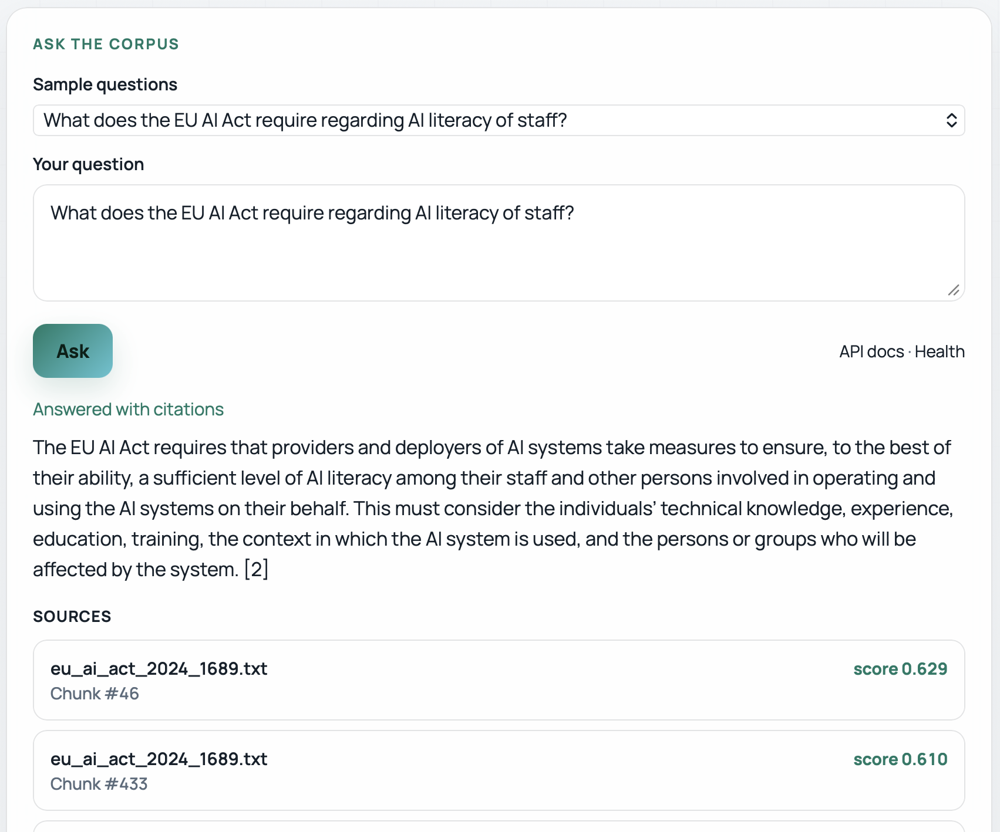
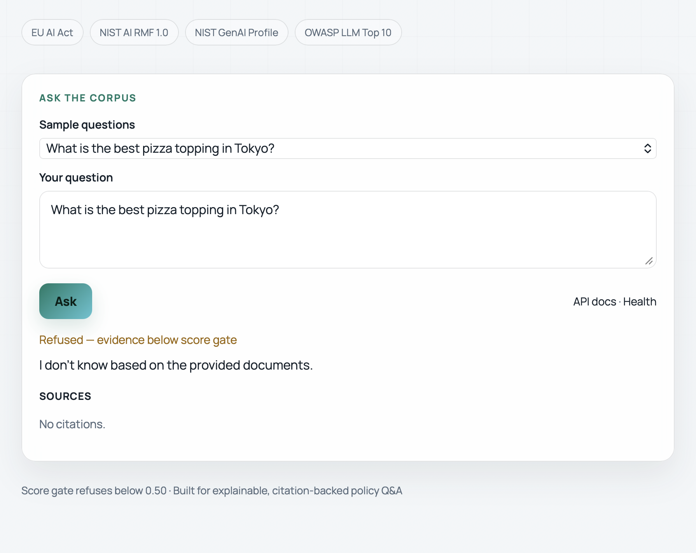
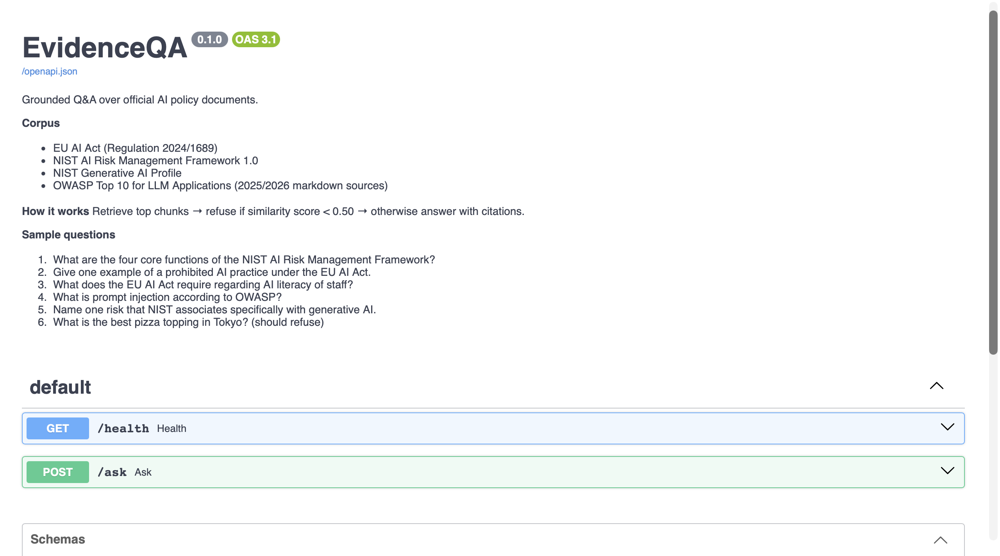
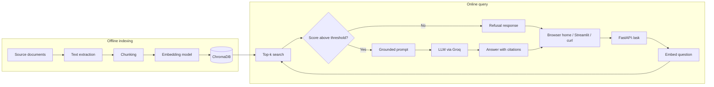

# EvidenceQA

**Grounded question answering over official AI policy and security documents, with source citations and evidence-based refusal.**

EvidenceQA answers questions using only a curated corpus of public documents: the EU AI Act, the NIST AI Risk Management Framework, the NIST Generative AI Profile, and the OWASP Top 10 for LLM Applications. Every answer is generated from retrieved passages and returned with its sources. When the documents do not contain enough evidence, the system declines to answer instead of guessing.

> EvidenceQA is a research and portfolio project. Its output is not legal or compliance advice.

---

## Table of contents

- [Highlights](#highlights)
- [Demo](#demo)
- [How it works](#how-it-works)
- [Architecture](#architecture)
- [Corpus](#corpus)
- [Getting started](#getting-started)
- [API reference](#api-reference)
- [Evaluation](#evaluation)
- [Testing](#testing)
- [Docker](#docker)
- [Deployment](#deployment)
- [Configuration](#configuration)
- [Project structure](#project-structure)
- [Tech stack](#tech-stack)
- [Limitations](#limitations)
- [Roadmap](#roadmap)

---

## Highlights

- **Retrieval-augmented generation built from first principles.** Ingestion, chunking, embedding, vector search, and prompt assembly are implemented directly, without an orchestration framework, so every stage is inspectable and testable.
- **Evidence gate enforced in code.** If no retrieved passage meets a similarity threshold, the API returns a refusal and never calls the language model.
- **Citations on every answer.** Responses include the source document, chunk position, and similarity score for each passage used.
- **Measured, not assumed.** A hand-labelled evaluation set tracks refusal accuracy and retrieval quality, and failure cases are documented.
- **Production-style service.** FastAPI with typed request/response schemas, structured error handling, request-level logging, automated tests, and a Docker image.

---

## Demo

**Live deployment (free):** [https://evidenceqa.onrender.com](https://evidenceqa.onrender.com)

| Link | What to try |
|---|---|
| [Home](https://evidenceqa.onrender.com/) | Sample questions, answer + citations, light/dark theme |
| [Health](https://evidenceqa.onrender.com/health) | Service status and index readiness |
| [API docs](https://evidenceqa.onrender.com/docs) | Interactive OpenAPI (`Try it out`) |

Render Free spins the service down after idle time. The first request after sleep can take about one minute.

Optional local screenshots for the repository (add under `docs/screenshots/`):

| Grounded answer with sources | Refusal when evidence is missing |
|---|---|
|  |  |



---

## How it works

1. **Ingest.** PDF and Markdown documents are converted to plain text.
2. **Chunk.** Text is split into overlapping windows (800 characters, 150 overlap) so passages stay self-contained.
3. **Embed.** Each chunk is encoded with `sentence-transformers/all-MiniLM-L6-v2` (FastEmbed / ONNX at runtime) into a normalized vector.
4. **Index.** Vectors, text, and metadata (source file, chunk index) are persisted in ChromaDB using cosine distance.
5. **Retrieve.** A question is embedded and the top-k most similar chunks are returned with similarity scores.
6. **Gate.** If no chunk reaches the minimum score, the request is refused without a model call.
7. **Generate.** Otherwise, the retrieved chunks are placed in a constrained prompt and the LLM answers using only that context, citing passages by label.

---

## Architecture



### Request lifecycle

```text
POST /ask
  |
  |-- invalid or empty question      -> 400 Bad Request
  |-- vector index missing or empty  -> 503 Service Unavailable
  |-- retrieval + evidence gate
  |     |-- no passage above threshold -> 200, refused = true  (no LLM call)
  |     |-- passages above threshold   -> LLM generation
  |-- LLM provider failure           -> 503 (generic message; details logged server-side)
  `-- success                        -> 200, answer + citations + scores
```

---

## Corpus

All documents are publicly available. Full source links are listed in [`data/README.md`](data/README.md).

| Document | Publisher | Coverage |
|---|---|---|
| Regulation (EU) 2024/1689 — Artificial Intelligence Act | European Union | Obligations, prohibited practices, AI literacy, governance |
| AI Risk Management Framework 1.0 (NIST AI 100-1) | NIST | Core functions: Govern, Map, Measure, Manage |
| Generative AI Profile (NIST AI 600-1) | NIST | Risks specific to or amplified by generative AI |
| OWASP Top 10 for LLM Applications 2026 | OWASP GenAI Security Project | Ranked LLM application risks |
| LLM01: Prompt Injection | OWASP | Attack patterns and mitigations |
| LLM09: Vector and Embedding Weaknesses | OWASP | Risks in retrieval and vector stores |

Index size: **1,426 chunks** across 6 documents.

---

## Getting started

### Prerequisites

- Python 3.11+
- A [Groq](https://console.groq.com) API key (free tier is sufficient)

### 1. Clone and install

```bash
git clone https://github.com/anmolrwt-77/evidenceqa.git
cd evidenceqa
python3 -m venv venv
source venv/bin/activate
pip install -r requirements.txt
```

### 2. Configure environment

```bash
cp .env.example .env
```

```env
GROQ_API_KEY=your_key_here
GROQ_MODEL=openai/gpt-oss-20b
```

### 3. Build the index

```bash
python scripts/ingest_docs.py
python scripts/build_index.py
```

Expected output ends with `Stored vectors: 1426`.

### 4. Start the API

```bash
uvicorn src.api:app --reload --port 8000
```

- Home page (sample questions): http://127.0.0.1:8000/
- Health check: http://127.0.0.1:8000/health
- API docs: http://127.0.0.1:8000/docs

### 5. Start the Streamlit UI (optional)

In a second terminal:

```bash
streamlit run ui/app.py
```

The browser home page and Streamlit are thin clients. Retrieval, gating, and generation always happen in the API.

---

## API reference

### `GET /`

Recruiter-facing HTML home page with corpus context, sample questions, and an Ask form. Not listed in the OpenAPI schema.

### `GET /health`

```json
{
  "status": "ok",
  "service": "evidenceqa",
  "min_score": 0.5,
  "index_ready": true
}
```

`status` is `degraded` when the vector index is missing or empty.

### `POST /ask`

**Request**

```json
{
  "question": "What are the four core functions of the NIST AI Risk Management Framework?"
}
```

**Response (answered)**

```json
{
  "answer": "The four core functions are GOVERN, MAP, MEASURE, and MANAGE [1].",
  "citations": [
    { "source": "nist_ai_rmf_1.0.txt", "index": 81, "score": 0.7524 },
    { "source": "nist_ai_rmf_1.0.txt", "index": 17, "score": 0.7454 },
    { "source": "nist_ai_rmf_1.0.txt", "index": 149, "score": 0.7315 }
  ],
  "scores": [0.7524, 0.7454, 0.7315],
  "refused": false
}
```

**Response (refused)**

```json
{
  "answer": "I don't know based on the provided documents.",
  "citations": [],
  "scores": [],
  "refused": true
}
```

| Status | Meaning |
|---|---|
| `200` | Answered or refused (see `refused`) |
| `400` | Empty question |
| `422` | Malformed request body |
| `503` | Index not ready or LLM provider unavailable |
| `500` | Unexpected server error |

---

## Evaluation

A hand-labelled set of 15 questions ([`eval/questions.json`](eval/questions.json)) covers both answerable questions and out-of-scope questions that must be refused.

| Metric | Result |
|---|---|
| Refusal accuracy (out-of-scope questions) | **6 / 6 (100%)** |
| Source hit rate (answerable questions) | **7 / 9 (78%)** |
| Keyword hit rate (answerable questions) | **6 / 9 (67%)** |

**Observed failure modes** (details in [`eval/results.md`](eval/results.md)):

- Questions about a specific OWASP entry sometimes retrieve the summary list instead of the detailed entry document.
- When several valid answers exist, the model may choose a different correct item than the labelled one.
- Yes/no phrasing occasionally leads the model to decline despite relevant context being retrieved.

Reproduce:

```bash
python scripts/run_eval.py
```

An embedding sanity check is recorded in [`eval/embedding_sanity.md`](eval/embedding_sanity.md): semantically related policy sentences score 0.74 cosine similarity versus 0.05–0.10 for unrelated pairs.

---

## Testing

```bash
PYTHONPATH=. pytest -q
```

| Area | What is verified |
|---|---|
| Chunking | Short input produces chunks; empty input produces none; invalid overlap is rejected |
| API | Health endpoint contract; empty questions return 400 |
| Evidence gate | Empty retrieval returns a refusal and the LLM is never invoked |
| Resilience | Missing index and LLM failures return 503 with safe messages |

External services (vector store, LLM) are mocked in gate and resilience tests, so the suite runs offline and in seconds.

---

## Docker

Build the API image (includes the prebuilt `.chroma` index):

```bash
docker build -t evidenceqa-api .
```

Run:

```bash
docker run --rm -p 8000:8000 --env-file .env evidenceqa-api
```

Alternatively, mount a local index at runtime:

```bash
docker run --rm -p 8000:8000 --env-file .env \
  -v "$PWD/.chroma:/app/.chroma" \
  evidenceqa-api
```

Secrets are injected at runtime and are never baked into the image.

---

## Deployment

**Live URL:** [https://evidenceqa.onrender.com](https://evidenceqa.onrender.com)

### Render Free (current setup)

EvidenceQA is deployed as a **Docker** web service on [Render](https://render.com) Free.

What makes 512 MB work:

- Embeddings use **FastEmbed (ONNX)** instead of PyTorch `sentence-transformers`
- The API image installs a slim dependency set (`requirements-api.txt`)
- The embedding model is downloaded during the Docker build
- The prebuilt `.chroma` index is copied into the image (no rebuild at startup)

Required environment variables on Render:

| Key | Value |
|---|---|
| `GROQ_API_KEY` | Your Groq secret (set in the Render dashboard, never in Git) |
| `GROQ_MODEL` | `openai/gpt-oss-20b` (optional; same default as local) |

The container listens on the platform-provided `PORT`. Free instances sleep after about 15 minutes without traffic; the first request after sleep can take about one minute.

Memory check during development: the image was verified locally with `docker run --memory=512m` and stayed under the limit during `/ask`.

---

## Configuration

| Variable / setting | Location | Default | Purpose |
|---|---|---|---|
| `GROQ_API_KEY` | `.env` | — | LLM provider credential (required) |
| `GROQ_MODEL` | `.env` | `openai/gpt-oss-20b` | Chat model identifier |
| `MIN_SCORE` | `src/config.py` | `0.50` | Evidence gate threshold |
| `REFUSE_MESSAGE` | `src/config.py` | `I don't know based on the provided documents.` | Refusal text |
| `CHUNK_SIZE` / `OVERLAP` | `scripts/build_index.py` | `800` / `150` | Chunking window |
| `k` | `src/generate.py` | `3` | Passages retrieved per question |

---

## Project structure

```text
evidenceqa/
├── src/
│   ├── api.py           # FastAPI app: routes, schemas, error handling
│   ├── config.py        # Environment loading and tunable settings
│   ├── ingest.py        # PDF / Markdown text extraction
│   ├── chunk.py         # Overlapping text chunking
│   ├── embed.py         # Embedding model wrapper and cosine similarity
│   ├── store.py         # ChromaDB persistence and queries
│   ├── retrieve.py      # Top-k retrieval with score filtering
│   └── generate.py      # Prompt assembly, LLM call, evidence gate
├── scripts/
│   ├── ingest_docs.py   # Extract text from data/raw
│   ├── build_index.py   # Chunk, embed, and persist the index
│   ├── ask.py           # Command-line question answering
│   ├── run_eval.py      # Run the evaluation set
│   └── start.sh         # Container entrypoint
├── ui/
│   └── app.py           # Streamlit client
├── tests/               # pytest suite
├── eval/                # Evaluation set and results
├── data/
│   ├── raw/             # Source documents
│   └── README.md        # Corpus provenance
├── docs/screenshots/    # README images
├── Dockerfile
├── requirements.txt       # Local / full install
├── requirements-api.txt   # Slim install for the API container
└── .env.example
```

---

## Tech stack

| Layer | Technology |
|---|---|
| Language | Python |
| API | FastAPI, Uvicorn, Pydantic |
| Embeddings | FastEmbed / ONNX (`sentence-transformers/all-MiniLM-L6-v2`) |
| Vector store | ChromaDB (persistent, cosine) |
| LLM | Groq (OpenAI-compatible API) |
| Document parsing | pypdf |
| UI | Built-in HTML home page + optional Streamlit client |
| Testing | pytest, FastAPI TestClient |
| Packaging | Docker |
| Hosting | Render Free |

---

## Limitations

- **Fixed corpus.** Questions are answered only from the six indexed documents.
- **PDF extraction artifacts.** Some PDF text contains spacing errors (for example, split words), which can reduce retrieval quality.
- **Dense retrieval only.** Exact terms such as article numbers or risk IDs are sometimes better matched by keyword search. Eval failures on Q2/Q6 (OWASP IDs) and Q8 (Article 5 wording) reflect this.
- **Single threshold.** One global similarity threshold (`MIN_SCORE = 0.50`) may be too strict for some phrasings and too lenient for others.
- **Citation granularity.** Citations identify the document and chunk, not the page or exact sentence.
- **Free hosting cold start.** Render Free sleeps after idle time; the first request can be slow.

---

## Roadmap

- [ ] Document upload: ingest user-provided files and query them
- [ ] Clickable citations that open the source document at the cited passage
- [ ] Hybrid retrieval (BM25 + dense) with reranking
- [ ] Page-level metadata for precise citations
- [ ] Larger evaluation set with retrieval@k and answer faithfulness metrics
- [ ] Request latency and token-usage monitoring

---

## License and data

Code is provided for educational and portfolio purposes. Source documents remain the property of their respective publishers and are used under their public availability terms; see [`data/README.md`](data/README.md).
